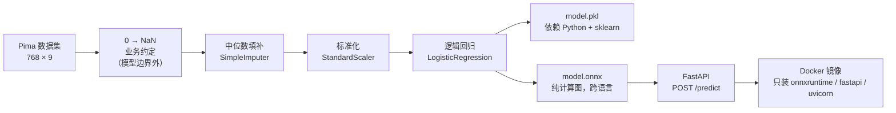

# 糖尿病预测模型服务

用 Pima Indians Diabetes 数据集训练一个患病概率预测模型，并部署为可调用的 HTTP API。
走完整条链路：**数据 → 预处理 → 训练 → ONNX 导出 → FastAPI 服务 → Docker 容器**。

## 架构



关键点：预处理（填补 + 标准化）和分类器被打包成**一条 Pipeline**，导出时整体转成 ONNX。
推理端因此不需要 sklearn，也不会出现"训练时做了、推理时忘了做"的偏差。

## 快速开始

需要 Docker。

```bash
git clone <仓库地址>
cd diabetes-prediction
docker build -t diabetes-api .
docker run -p 8000:8000 diabetes-api
```

启动后：

- 交互式文档：<http://127.0.0.1:8000/docs>
- 预测接口：`POST http://127.0.0.1:8000/predict`

## 调用示例

```bash
curl -X POST http://127.0.0.1:8000/predict \
  -H "Content-Type: application/json" \
  -d '{"pregnancies":6,"glucose":148,"blood_pressure":72,"skin_thickness":35,"insulin":0,"bmi":33.6,"diabetes_pedigree":0.627,"age":50}'
```

返回：

```json
{
  "probability": 0.7058118581771851,
  "prediction": 1,
  "threshold": 0.5
}
```

字段说明：

| 字段 | 含义 |
|---|---|
| `probability` | 患病概率（0~1），与阈值无关 |
| `prediction` | 按 `probability >= threshold` 判定，1 = 患病 |
| `threshold` | 判定阈值，默认 0.5，可随请求传入（0~1） |

**阈值是运行时的决定，不是训练时的。** 医疗筛查场景若要求"宁可误报、不可漏诊"，
应**降低**阈值（如 0.3），而不是升高。

输入字段带有范围校验（见 `api/main.py`），类型合法但数值荒谬的请求（如血糖 -999）会返回 `422`。

## 本地开发（不用 Docker）

```powershell
pip install -r requirements.txt
python train\train.py          # 下载数据 → 训练 → 评估 → 保存 model.pkl
python export\export_onnx.py   # 导出 model.onnx 并做一致性验证
python -m uvicorn api.main:app --reload
```

## 结果

| 指标 | 数值 |
|---|---|
| 测试集准确率 | **0.7078** |
| 测试集 AUC | **0.8130** |
| ONNX 与 pickle 的最大概率误差 | **4.6e-08**（要求 < 1e-5） |
| Docker 镜像体积 | **409MB** |

说明：

- 测试集只有 154 人（768 × 20%），**每答错 1 人，准确率变化约 0.65%**，
  因此 0.71 与 0.78 之间的差异未必有统计意义。这也是同时看 AUC 的原因。
- AUC 衡量排序能力，与阈值无关；准确率依赖阈值。两者要一起看。

## 项目结构

```
diabetes-prediction/
├── data/diabetes.csv          # 数据集（train.py 在缺失时自动下载）
├── train/train.py             # 训练：缺失值处理 → 流水线 → 评估 → 保存
├── export/export_onnx.py      # 导出 ONNX + 与 pickle 的一致性验证
├── api/main.py                # FastAPI 服务（Pydantic 校验 + ONNX 推理）
├── model/
│   ├── model.pkl              # 训练好的完整流水线（含预处理）
│   └── model.onnx             # 部署用模型，服务只依赖它
├── Dockerfile                 # 服务镜像
├── .dockerignore              # 训练数据和训练脚本不进镜像
├── requirements.txt           # 训练 + 开发依赖
└── requirements-serve.txt     # 仅服务运行依赖（不含 sklearn）
```

## 踩坑记录

1. **`Unable to find column name 'glucose'`**
   sklearn 用列名指列，ONNX 只认位置。`ColumnTransformer` 按列名配置时无法转换。
   解决：预处理改用位置索引 `[1, 2, 3, 4, 5]`。

2. **`Unsupported proposed value '0'`（SimpleImputer）**
   skl2onnx 的 imputer 只支持 `missing_values=np.nan`，不支持把 `0` 声明为缺失。
   解决：把 `0 → NaN` 移到 Pipeline 之外，`SimpleImputer` 用默认的 `np.nan`。
   代价是这条业务约定要在训练、导出、服务三处各写一次。

3. **pickle 的边界**
   `model.pkl` 序列化的是 Python 对象，加载需要相同版本的解释器和 sklearn，
   非 Python 服务无法使用。ONNX 存的是标准算子图，任何语言 + onnxruntime 都能跑。

4. **`--reload` 不重载模型**
   uvicorn 的 `StatReload` 只监听 `.py` 文件。替换 `model.onnx` 不会重启服务，
   会静默继续使用旧模型。换模型后需手动重启。

5. **构建时的网络问题**
   - `failed to resolve source metadata for docker.io/...`：拉不到 Docker Hub → 配置 registry mirror
   - `ReadTimeoutError: files.pythonhosted.org`：pip 下载超时 → Dockerfile 默认使用清华源，
     境外构建可用 `--build-arg PIP_INDEX_URL=https://pypi.org/simple` 覆盖

6. **概率差 1e-8 不是 bug**
   pickle 走 float64，ONNX 走 float32。两个不同精度、独立重算的结果不可能逐位相同。
   判据是量级：`1e-5` 以内属数值噪声，远小于业务上有意义的差异。

## 局限与改进

- **模型**：仅逻辑回归 + 8 个原始特征，Pima 数据集噪声大，性能上限约 0.75~0.78。
  可做特征工程、交叉验证、对比树模型。
- **阈值**：目前默认 0.5，未按医疗场景的召回要求调优。应基于验证集选取阈值，
  并同时报告 recall / precision。
- **缺失值**：`insulin` 约 48.7% 为 0，中位数填补会稀释该列信息，可考虑丢弃或做缺失指示特征。
- **工程**：服务尚无鉴权、限流、结构化日志与异常兜底（下一步）。

## 技术栈

Python · pandas · scikit-learn · joblib · skl2onnx · onnxruntime · FastAPI · Pydantic · uvicorn · Docker
